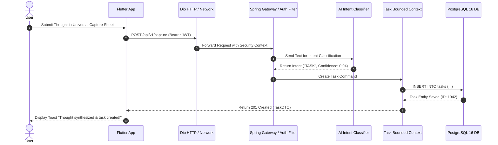

# Cross-Module System Data Flows (LifeOS)

## 1. Document Definition

### Purpose
The **Cross-Module System Data Flows** document details multi-step orchestration scenarios where data originates in one domain (e.g., Universal Capture) and propagates asynchronously across multiple bounded context services and database stores (e.g., Tasks, AI Vector Store, Calendar).

### Structure
1. **Universal Capture to Task Creation Flow**
2. **AI Stream Conversation & Vector Context Retrieval Flow**
3. **Financial Transaction & Budget Alert Flow**
4. **Life Profile Switching & Context Refresh Flow**

### How it Will be Updated
- Updated when cross-service workflows or domain event triggers are modified.

### Owner
- **Primary Owner:** Solution Architect
- **Co-Owner:** Backend Integration Lead

### Completion Criteria
- Sequence diagrams and state transition specifications documented for all cross-module journeys.

---

## 2. Universal Capture Sequence Flow

