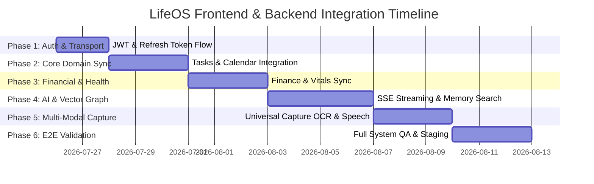

# Master Integration Plan (LifeOS)

## 1. Document Definition

### Purpose
The **Master Integration Plan** serves as the authoritative blueprint for bridging the Flutter frontend (`frontend/`) and the Spring Boot backend (`backend/`) of LifeOS. It outlines the architectural integration phases, environment configurations, API transport protocols (REST HTTP/2 & SSE streaming), authentication Handshakes (JWT + Refresh Tokens), and execution timelines required to achieve full system orchestration without altering existing frozen business logic.

### Structure
1. **Executive Overview & Scope**
2. **Integration Principles & Non-Negotiable Directives**
3. **Environment & Infrastructure Topology**
4. **Phased Integration Roadmap (Phases 1 through 6)**
5. **Data Flow & Transport Protocols**
6. **Risk Management & Fallback Strategies**
7. **Sign-off Governance Matrix**

### How it Will be Updated
- Updated at the completion of each Integration Phase by the Lead Systems Architect.
- Modifications require approval from both Frontend Lead and Backend Integration Specialist.
- Version increments follow Semantic Versioning (`v1.0.0`, `v1.1.0`).

### Owner
- **Primary Owner:** Lead Integration Engineer / Systems Architect
- **Co-Owners:** Flutter UI Lead, Spring Boot Backend Architect

### Completion Criteria
- 100% of integration phases executed with zero API contract mismatches.
- End-to-end integration verified against staging database with all 18 Bounded Contexts passing automated health checks.

---

## 2. Integration Principles
1. **Zero Architecture Mutation:** Frontend components and backend Spring Boot controllers MUST NOT be redesigned; integration utilizes existing API contracts.
2. **Strict Contract Compliance:** All Dio HTTP client requests in Flutter must align with Spring Boot OpenAPI 3.0 schemas.
3. **Resilient Offline Fallback:** Unsent capture inputs persist locally via Hive DB and queue for auto-retry upon network reconnection.
4. **Zero Trust Security:** Every request outside `/api/v1/auth/**` requires a valid Bearer JWT header.

---

## 3. Phased Integration Roadmap

