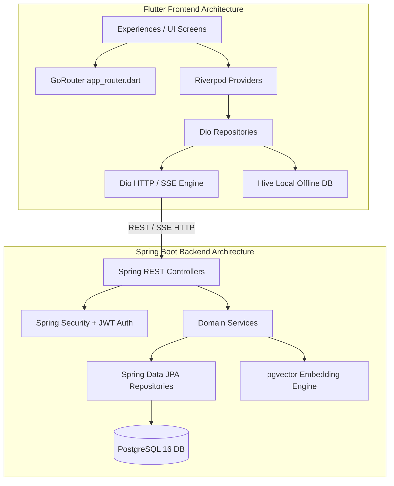

# Module Dependencies (LifeOS)

## 1. Document Definition

### Purpose
The **Module Dependencies** document defines the structural relationships, build graphs, internal package linkages, and runtime dependencies between the Flutter frontend modules and Spring Boot backend micro-components.

### Structure
1. **Frontend Architecture Package Graph (Riverpod, GoRouter, Dio, Hive)**
2. **Backend Module Hierarchy (Maven Submodules, PostgreSQL, pgvector, Spring Security)**
3. **Cross-Boundary Dependency Matrix**
4. **Third-Party Service Integration Dependencies (OpenAI API, FCM, Local Notification Engine)**

### How it Will be Updated
- Updated whenever a new internal package, Maven artifact, or external API integration is introduced.

### Owner
- **Primary Owner:** DevOps & Enterprise Build Engineer
- **Co-Owner:** Frontend Architect

### Completion Criteria
- All 18 Bounded Contexts mapped with zero circular dependencies or unresolved runtime imports.

---

## 2. Dependency Matrix

