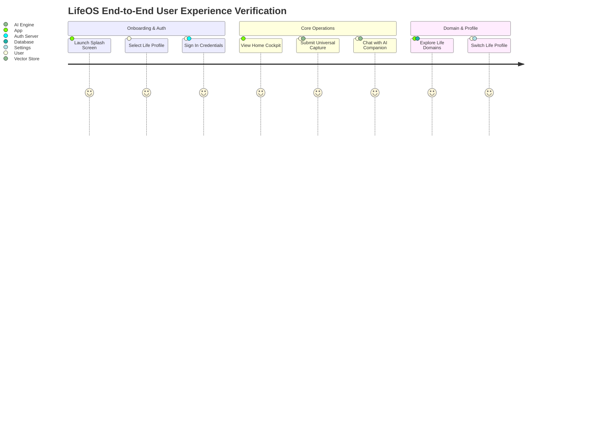

# End-to-End (E2E) Integration Test Scenarios (LifeOS)

## 1. Document Definition

### Purpose
The **End-to-End (E2E) Integration Test Scenarios** document defines full system integration test workflows spanning from the Flutter user interface through network Dio transport to Spring Boot business logic, PostgreSQL persistence, and AI vector classification.

### Structure
1. **E2E Scenario 1: New User Onboarding & Auth Journey**
2. **E2E Scenario 2: Universal Capture to Priority Task Synthesis**
3. **E2E Scenario 3: AI Companion Stream Conversation & RAG Retrieval**
4. **E2E Scenario 4: Life Domain Navigation & Financial Expense Logging**
5. **E2E Scenario 5: Life Profile Switcher & Context Synchronization**

### How it Will be Updated
- Updated whenever new user flows or system integrations are added.

### Owner
- **Primary Owner:** Lead E2E Test Automation Engineer

### Completion Criteria
- Automated execution of all 5 core scenarios with 100% pass rate in CI pipeline.

---

## 2. E2E Test Scenarios Specification

### Scenario 1: Universal Capture to Task Orchestration
1. **Pre-condition:** User is authenticated on Home Cockpit (`/`).
2. **Action:** User taps center FAB **"+"**, opens `UniversalCaptureModal`, types *"Review Spring Boot JWT Security Review tomorrow at 2pm"*, and submits.
3. **Network:** Dio sends `POST /api/v1/capture`.
4. **Backend:** Spring Boot AI service classifies intent as `TASK`, creates a new Task record in PostgreSQL DB (`id: 1042`).
5. **Assertion:** App displays toast notification *"Thought captured & task created!"*, and Task item `#1042` appears automatically under Today's Priorities list on `HomeScreen`.
